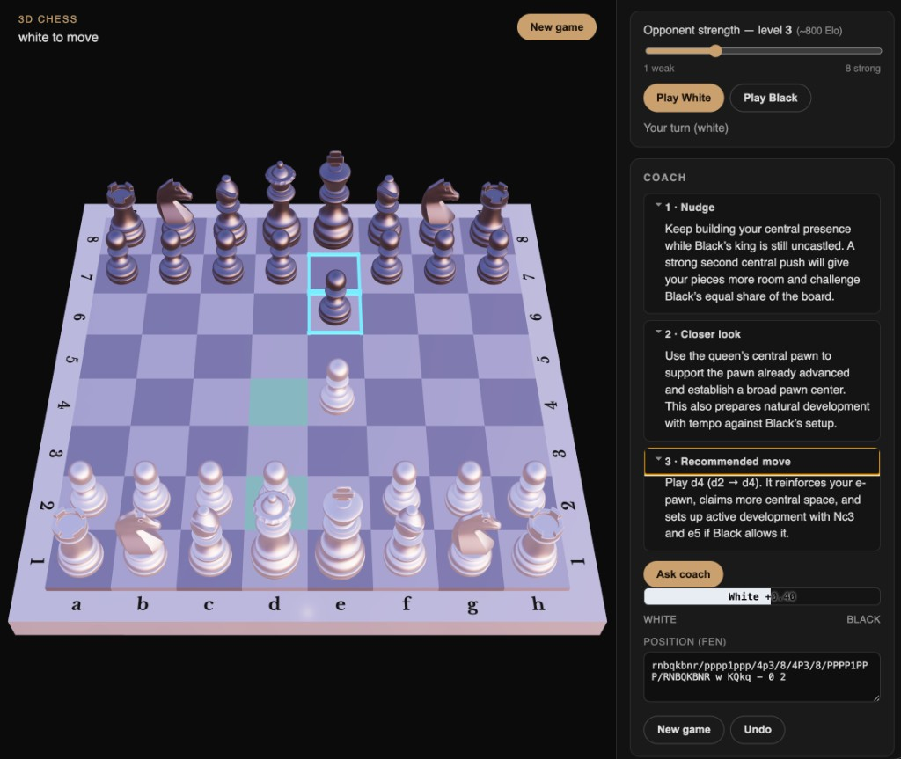

# Learn Chess

Local 3D chess with a Stockfish opponent and an LLM coach that gives progressive tips aligned to the engine’s best move.



## Requirements

- **Node.js** 20+ (npm)
- A machine that can run WebAssembly (Stockfish in the browser)

## Run

```bash
git clone git@github.com:protoEvangelion/learn-chess.git
cd learn-chess
npm install
npm run dev
```

Open the URL Vite prints (default [http://127.0.0.1:5173](http://127.0.0.1:5173)).

Optional:

```bash
npm run dev -- --host 127.0.0.1 --port 5174
```

### Coach (optional)

`Ask coach` calls DeepSeek V4.1 Flash through Vercel AI Gateway. Link the
project to Vercel and run `vercel env pull .env.local` for local Gateway
authentication, or set `AI_GATEWAY_API_KEY`. Override the model with:

```bash
AI_COACH_MODEL=deepseek/deepseek-v4.1-flash npm run dev
```

Each game gets a `gameId` in the URL, and recent visible chat turns are sent
with follow-up questions so the stateless model can follow the conversation.

Production opening cards are curated ahead of time and stored in Turso;
DeepSeek is used only for live coaching. After deploying card changes, seed
the database with:

```bash
OPENING_CARD_BASE_URL=https://your-project.vercel.app npm run seed:opening-cards
```

Local development uses the Turso dev database (`TURSO_DATABASE_URL` and `TURSO_AUTH_TOKEN` in `.env.local`). Production uses a second database with the same variable names. Vercel Preview should use the dev database.

## Features

- 3D board with move animations, capture bursts, and SFX
- Board / piece / room themes (Settings) with curated offline assets
- Play as White or Black vs Stockfish (strength 1–8)
- Eval bar, material imbalance, check highlight, last-move glow
- Progressive coach tips (nudge → closer look → full move) tied to Stockfish
- Position in the URL (`fen` + `gameId`); **Undo** is browser back

## Opening explorer

The Explore tab reads counts from a local SQLite file, `.data/explorer-2026-09.sqlite`. It does not call Lichess for those counts. Opening names come from a separate book. Stockfish evals are not stored. The steps to build another month are in [docs/explorer-db-plan.md](docs/explorer-db-plan.md).

### Which games are in the file

| Lichess speed | In this file |
| --- | --- |
| Ultrabullet | Dropped |
| Bullet | Dropped |
| Blitz | Kept |
| Rapid | Kept |
| Classical | Kept |
| Correspondence | Dropped |

Speed is Lichess’s clock estimate, `initial + 40 × increment`: blitz 180–479, rapid 480–1499, classical 1500–21599. The dump is already standard and rated. Bots, missing ratings, and unfinished games are dropped. Only the first 50 plies are counted. The game’s result still counts. A board or move is kept when its games add up to at least 100 across every speed and rating band.

### Why there are two tables

`explorer_position` is every game that reached that board. That number is the parent in the % column. `explorer_move` is one reply from that board, and how those games ended. A click loads the parent once, then lists the replies.

`white`, `draws`, and `black` are how many games ended that way, not the pieces on the board.

One table of moves cannot supply the parent. A game can reach a board and then end, or stop at the 50-ply cap, so there is no next move to store. Rare replies are also dropped when the board itself is kept. Adding the remaining replies then comes out short of the games that actually reached the board. The position row keeps that full count.

| Column | Meaning |
| --- | --- |
| `speed` | `blitz`, `rapid`, or `classical`. |
| `rating_band` | `0`, `1000`, `1200`, `1400`, `1600`, `1800`, `2000`, `2200`, or `2500`. The average of the two ratings, floored into one of these. |
| `position` | FEN, first four fields. Clocks stripped. |
| `uci` | Move id, such as `e2e4`. Moves table only. |
| `san` | Move label, such as `e4`. Moves table only. |
| `white`, `draws`, `black` | Games with that result. |
| `month` | `YYYY-MM`. September’s file does not have this column yet. |

One row is one speed, one rating band, and one board. A move row is that plus one reply. A speed × band cell under 100 is still stored when that cell is not zero and the board’s total is at least 100, so the replies can add up to less than the board total.

### Why the indexes exist

A click asks one question: for this board, in these rating bands and speeds, what are the totals and the replies? The September file has 8.4 million position rows and 8.3 million move rows. Without an index, SQLite reads every row and keeps the ones whose FEN matches.

An index is a second list, sorted, that points back at the real rows. The table still holds the counts. The index only makes the lookup jump.

SQLite can jump in on the leftmost columns and then walk forward. It cannot skip a column in the middle. Every click already knows the FEN, and the FEN throws away almost every row, so `position` is first. `rating_band` and `speed` are the filters after that. One board has at most 3 speeds × 9 bands = 27 position rows. The index jumps to that FEN and reads those 27, then the query adds up the ones the chips selected. The move index does the same, then groups by `uci` so each reply is one line.

All time leaves `month` out of the query, so that lookup index is the one that matches. A single month wants `month` right after `position`, or SQLite finds the FEN and then checks the month on each row. The next build adds that month index.

Each index is about as big as its table (658 MB and 642 MB). Indexes also slow inserts, because every new row updates the sorted list. The load writes the rows first. The indexes are created after the filter.

### Why the cutoff stays at 100

The wiggle on a win rate is about `1 / sqrt(n)`.

| Games | Typical wiggle on the win rate |
| --- | --- |
| 30 | about ±18 points |
| 50 | about ±14 points |
| 100 | about ±10 points |
| 400 | about ±5 points |

A 55% score in 30 games is noise. The displayed list keeps 100. The current file cannot be refiltered to 30 or 50. Rows under 100 were deleted, and the count pass never wrote boards the first pass estimated under 100.

### What the September build did

Machine: WSL, 24 GB RAM. The 27.2 GB dump stayed zipped. 89,616,462 games. The live file was built in chunks of **2,000,000** games. Pass 2 writes those chunks. The disk filter adds matching rows together and drops totals under 100. SQLite does not add the chunks. A chunk of 5,000,000 games was killed at about 3,000,000 games and 24 GB, so this machine stays at 2,000,000.

| Step | Time | RAM | Disk after the step |
| --- | --- | --- | --- |
| Pass 1 sketch | 27 min, from the first build. Reused. | 512 MB fixed | Two 256 MB files. No counts. |
| Pass 2 count, 2,000,000 games at a time | 49 min 34 sec | Peak 19.7 GB | Raw rows, 161 GB. Not yet filtered. |
| Disk filter, sum chunks and keep totals ≥ 100 | 52 min 36 sec | Peak 0.9 GB | 8,424,647 board rows and 8,262,321 move rows. `month` is `2026-09`. |
| Four indexes | 14 sec | small | |
| `VACUUM INTO` | 15 sec | small | **4.1 GB.** |

Without the sketch, that run took **1 hr 43 min**. The first build, also without the sketch, took **3 hr 18 min**. The disk-filter run was **1 hr 35 min** faster. Both totals are in [docs/explorer-build-comparison.md](docs/explorer-build-comparison.md).

The two sketch files are popularity counters from pass 1. Pass 2 reads them and skips a board that looks like it appeared in fewer than 100 games. The empty `group-position.done` and `group-move.done` files mean that filter already finished. Deleting a marker makes the next filter pass do that table again.

## Assets

Curated themes live under `public/assets/` (boards, pieces, rooms) and `public/sfx/`. Regenerate generated GLBs/SFX with:

```bash
node scripts/generate-assets.mjs
node scripts/generate-assets.mjs --sfx-only   # quiet CC0 wood taps only
```

| Theme | Notes |
|-------|--------|
| Classic board / Metal pieces | From [joshwrn/3d-chess](https://github.com/joshwrn/3d-chess) |
| Walnut board | Project-generated GLB (CC0) |
| Retro PC board + pieces | [Sketchfab](https://sketchfab.com/3d-models/retropc-chess-31e657b251b546e69e6ae312fc0bf66a) (split) |
| Glass board + pieces | [Al / chess-board](https://sketchfab.com/3d-models/chess-board-a0d61768bc504082901728ec9603fa0d) CC-BY (split) |
| Dining room | [Modern dining room](https://sketchfab.com/3d-models/modern-dining-room-df3f3c9f6233447eb8b7ee129f3bace5) |
| Realistic room | [Realistic room](https://sketchfab.com/3d-models/realistic-room-7b65ce7710b442d9932440d5b9812287) |
| Dawn HDR | Existing IBL preset |

When adding Sketchfab models: download a redistributable license (CC-BY/CC0), normalize origins (see `scripts/split-*.mjs`), drop into `public/assets/...`, and register in `src/lib/themes.ts`.

## Credits

- **3D chessboard, pieces, and core board logic** adapted from [joshwrn/3d-chess](https://github.com/joshwrn/3d-chess) by [joshwrn](https://github.com/joshwrn)
- **Stockfish** via the lite WASM build in `public/engines/`
- **chess.js** for FEN helpers and SAN labeling for the coach
- **Retro PC chess** — [Sketchfab](https://sketchfab.com/3d-models/retropc-chess-31e657b251b546e69e6ae312fc0bf66a)
- **Modern dining room** — [Sketchfab](https://sketchfab.com/3d-models/modern-dining-room-df3f3c9f6233447eb8b7ee129f3bace5)
- **Realistic room** — [Sketchfab](https://sketchfab.com/3d-models/realistic-room-7b65ce7710b442d9932440d5b9812287)
- **Qwantani noon HDR** — [Poly Haven](https://polyhaven.com/a/qwantani_noon) (CC0)
- **Glass chess board + pieces** — [Al (@lightningocelot)](https://sketchfab.com/3d-models/chess-board-a0d61768bc504082901728ec9603fa0d) (CC-BY)

## License

See upstream [joshwrn/3d-chess](https://github.com/joshwrn/3d-chess) for original board asset licensing; this project’s app code is provided as-is for learning use. Project-generated GLBs/SFX are CC0 (soft board taps in `public/sfx/`). Sketchfab assets retain their listed licenses (credit required for CC-BY).
