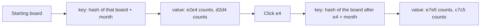

# Explorer cards

Plan only. Do not build until this is approved. The site keeps reading `.data/explorer-2026-09.sqlite` (4.1 GB, cutoff 100). April–August and the failed 476 GB file are already deleted.

Same idea as [Lichess's explorer](https://github.com/lichess-org/lila-openingexplorer): one card per board per month. We do not copy their source (AGPL). `explorer-rs` writes a smaller card, and the screen still calls `/api/opening-explorer`.



`e4`'s win rate is the three counts on the starting card's `e2e4` line, divided on click. The second card is a different key. Its counts belong to Black's replies.

## Sample card

Counts below are made up. The shape is the one we would store. Month is in the key, not the value. Empty speed and rating bands are left out.

```text
key (14 bytes)
  hash(starting board)     12 bytes
  2026-09                  2 bytes

value
  e2e4                     2 bytes, squares e2 → e4
    blitz / 1600           white 4000, draws 500, black 3500
    rapid / 1800           white 900,  draws 200, black 800
  d2d4                     2 bytes, squares d2 → d4
    blitz / 1600           white 3800, draws 600, black 3600
```

No FEN, no SAN, no game id. `e4` is spelled at click time from the piece on `e2`. A one-game reply is that 2-byte move plus three counts.

## What goes in

`lichess_db_standard_rated_YYYY-MM.pgn.zst`, year **2025-10 through 2026-09**. Do not unzip. 2026-04 through 2026-09 are already in `~/Downloads`.

- Every speed: ultraBullet, bullet, blitz, rapid, classical, correspondence.
- Every ply. The old 50-ply cap stays on the September SQLite file only.
- No 100-game cutoff.
- Drop bots (`WhiteTitle` or `BlackTitle` is `BOT`), unfinished games (`Result` is not `1-0`, `1/2-1/2`, or `0-1`), and games missing a rating.
- Rating bands stay `0`, `1000`, `1200`, `1400`, `1600`, `1800`, `2000`, `2200`, `2500`. Averages of 2500 and up stay in `2500`.

## Build, later

`.data/explorer-cards/` on RocksDB. Stream each dump, and for every kept ply read the card, add one to that move's band, write it back. About 336 GB of compressed dumps, several days, inside 24 GB of RAM. Delete each dump after its month is imported. About 780 GB is free on this 1 TB disk.

Do not write into the September SQLite file. Do not point the app at the cards until a later switch, which also adds the extra speed chips.

## Do not

- Do not start the build from this doc.
- Do not delete `.data/explorer-2026-09.sqlite`.
- Do not paste Lichess's source into this repo, or put this store on Turso.
